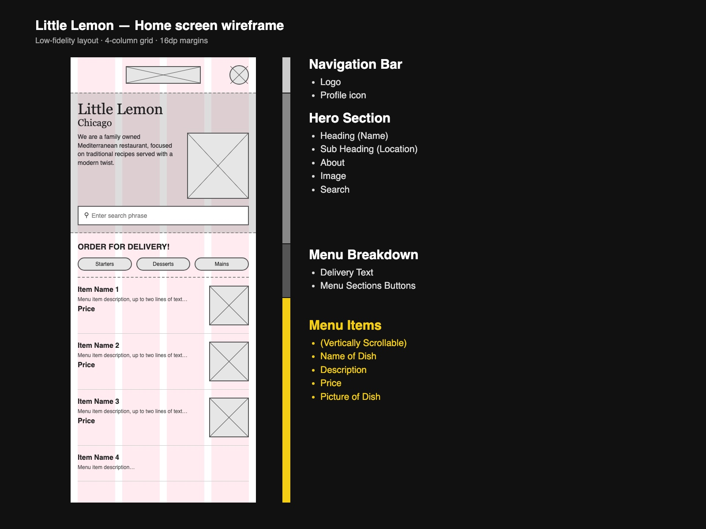
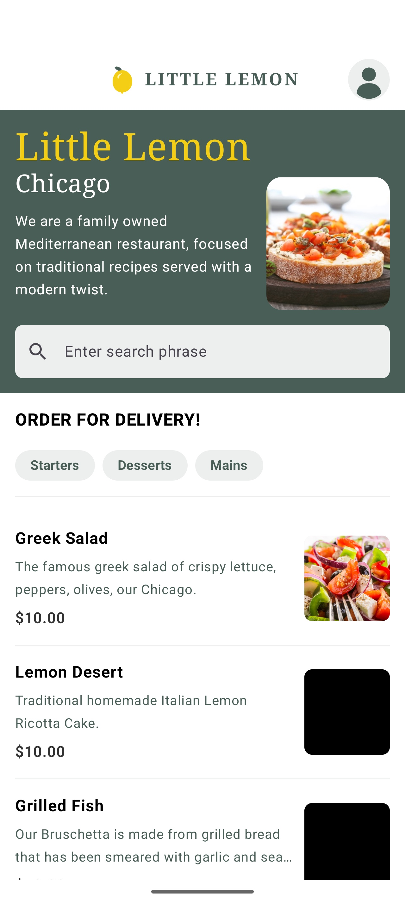

# Little Lemon — Android

Little Lemon food ordering app for Android, built with Kotlin and Jetpack Compose.
Capstone project for the Meta Android Developer course.

| Wireframe | App |
|---|---|
|  |  |

## Features

- **Onboarding** — shown on first launch; collects first name, last name and email.
- **Home** — header, hero (name, location, description, image, search bar), menu category
  filters and a scrollable menu list.
- **Profile** — shows the saved user data; **Log out** clears it and returns to Onboarding.
- User data persists across restarts (SharedPreferences); the menu is downloaded once with
  Ktor and cached in Room.
- Stack navigation with Navigation Compose (back button returns to the previous screen).

## Running

Open the project in Android Studio and run the `app` configuration on an emulator or device
(min SDK 26). An internet connection is needed on first launch to download the menu.

> Note: the "Lemon Desert" and "Grilled Fish" images in the course's menu API are solid
> black at the source, so they appear black in the app.
